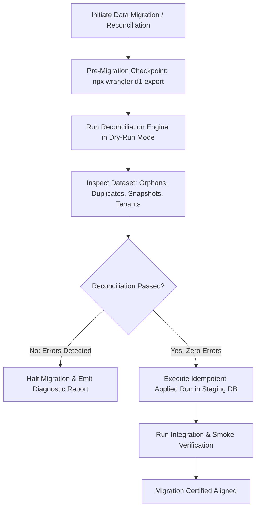

# Data Migration and Reconciliation Contract — AURA OS

## Executive Summary & Contract Status

This document establishes the canonical **Data Migration and Reconciliation Contract** across AURA OS. It defines the authoritative source of truth for each system entity, explicit data mapping/transformation specifications, execution ordering, dry-run reconciliation protocols, orphan/duplicate detection logic, and historical snapshot immutability guarantees.

---

## 1. Data Ownership & Mapping Matrix

| Entity Domain | Source Table (Legacy / Master) | Target Table (Current / Projection) | Canonical Master Owner | Key Preservation Strategy | Transformation Rule | Rollback & Recovery Strategy |
| :--- | :--- | :--- | :--- | :--- | :--- | :--- |
| **Catalog Products** | `products` | `menu_items` | `catalog_products` (`products` master) | Preserve canonical `TEXT` ID (e.g. `prod_cafe_sua_da`) | One-way projection synchronization. Master mutations only occur on `products` and project to `menu_items`. | Reverse projection refresh from `products`. |
| **Categories & Modifiers** | `categories`, `modifier_groups`, `modifier_choices` | `categories`, `menu_modifiers`, `product_modifier_groups` | `catalog_categories` & `catalog_modifiers` | Preserve `TEXT` slugs & group IDs (`cat_xxx`, `mod_grp_xxx`) | Direct copy & normalized relationship binding. | Down migration SQL rollback. |
| **Orders & Snapshots** | `orders` | `orders`, `order_items` | `order_master` (`orders`) | Preserve `TEXT` ID (`ord_xxx`, `item_xxx`) | Historical line item and JSON snapshots (`orders.items`) are **strictly immutable**. Catalog price changes never alter past order records. | Point-in-time D1 snapshot checkpoint. |
| **Customers & Visits** | `customers`, `checkins` | `customers`, `visits` | `customer_master` (`customers`) | Preserve `TEXT` ID (`cst_xxx`, `chk_xxx`) | Phone number E.164 normalization. Linking guest order to customer must be auditable without mutating historical snapshot order totals. | Revert customer link audit pointer. |
| **Payment Ledger** | `payments` | `payments` | `payment_ledger` (`payments`) | Preserve `TEXT` ID (`pay_xxx`) | Direct copy with uniqueness constraint on `transaction_id`. Settled amounts must reconcile against order `total_amount`. | Replay idempotency guard; down migration. |
| **Inventory & Recipes** | `ingredients`, `recipes` | `ingredients`, `recipes`, `stock_movements` | `inventory_master` (`ingredients`) | Preserve `TEXT` SKU & ID (`ing_xxx`, `mov_xxx`) | Stock movement ledger is append-only. Real stock is deterministic: `sum(in - out + adjust - waste)`. | Compensating movement record. |
| **Tenant Isolation** | `orders`, `customers`, `inventory_items`, `users` | All domain tables | `tenant_unit_master` | Preserve string `tenant_id` (`default`, `sadec_hq`) | Fallback unassigned legacy records to `default`. Cross-tenant mutations strictly rejected. | Reverse tenant assignment script. |

---

## 2. Canonical Migration Manifest (`manifest_20261009_canonical_reconciliation`)

```json
{
  "manifestId": "manifest_20261009_canonical_reconciliation",
  "version": "20261009_04",
  "timestamp": "2026-10-09T13:00:00Z",
  "description": "Authoritative data migration and multi-domain reconciliation manifest for AURA OS",
  "executionOrder": [
    "categories",
    "modifier_groups",
    "modifier_choices",
    "products",
    "menu_items",
    "customers",
    "staff_shifts",
    "orders",
    "order_items",
    "payments",
    "ingredients",
    "stock_movements"
  ],
  "preMigrationChecklist": [
    "Verify isolated staging database is online",
    "Execute pre-migration D1 backup export checkpoint",
    "Run Dry-Run reconciliation audit across all 7 domain mappings",
    "Assert 0 duplicate transaction_ids and 0 orphan order_items"
  ],
  "reconciliationCriteria": {
    "enforceForeignKeyIntegrity": true,
    "requireZeroOrphanRecords": true,
    "requireZeroDuplicateKeys": true,
    "preserveHistoricalOrderSnapshots": true,
    "reconcilePaymentAmounts": true
  }
}
```

---

## 3. Dry-Run Reconciliation Protocol & Execution Lifecycle



### Dry-Run Verification Rules:
1. **Zero Destructive Actions**: The dry-run engine reads and computes relationship parity without invoking `INSERT`, `UPDATE`, or `DELETE`.
2. **Orphan Record Detection**: Checks child entity foreign keys against parent IDs (e.g., `order_items.order_id NOT IN (SELECT id FROM orders)`).
3. **Duplicate Detection**: Validates uniqueness of fiscal transaction IDs and ingredient SKUs before any schema constraints are applied.
4. **Historical Snapshot Decoupling**: Verifies that live catalog price adjustments do not propagate into settled orders.

---

## 4. Test Evidence & Automated Verification

Dedicated contract verification suite executed via Vitest:

```bash
$ npx vitest run worker/src/__tests__/integrations/data-migration-reconciliation-contract.test.ts
 ✓ worker/src/__tests__/integrations/data-migration-reconciliation-contract.test.ts (6 tests) 4ms
   ✓ enforces canonical entity ownership and execution order in manifest
   ✓ projects canonical products to legacy menu items accurately and idempotently
   ✓ preserves historical order snapshots regardless of catalog price changes
   ✓ detects orphan child records during dataset inspection
   ✓ detects duplicate payment transaction hashes to prevent fiscal collisions
   ✓ generates comprehensive dry-run reconciliation report

 Test Files  1 passed (1)
      Tests  6 passed (6)
   Duration  603ms
```

### Full Project Regression Gate:
```bash
$ npx vitest run
 Test Files  432 passed (432)
      Tests  3896 passed (3896)
   Duration  60.67s

$ npm run typecheck
> tsc --noEmit (0 errors)

$ npm run typecheck:worker
> tsc --project worker/tsconfig.json --noEmit (0 errors)

$ npm run lint
> eslint worker/src/ --ext .ts (0 errors, 0 warnings)

$ npm run build
vite: build ok (dist/ generated cleanly)
```

---

## 5. Blockers & Residual Risks

1. **External Legacy Data Gaps**: Any legacy data import from external sources (e.g., ERPNext, old CSV files) must be fully validated in isolated staging first. Ingestion is strictly blocked if required foreign keys or currency units are missing.
2. **Third-Party Payment Webhooks**: Webhook delivery replays from PayOS or SePay are protected by the `payment_transactions` unique index, ensuring replay idempotency without creating ledger drift or duplicate inventory consumption.
