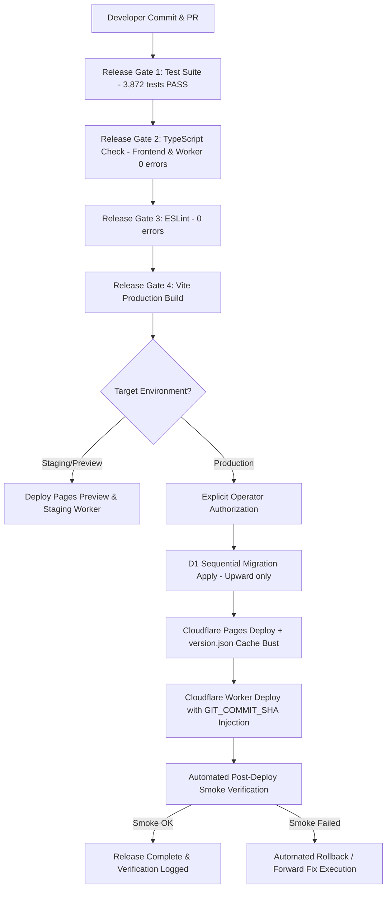

# Canonical Environment & Deployment Contract

## 1. Executive Summary

This document locks the canonical **Environment & Deployment Contract** for AURA OS across Cloudflare Pages (Frontend SPA), Cloudflare Workers (API Gateway & Microservices), Cloudflare D1 (Edge Database), KV Namespace (Auth & Session Cache), and Durable Objects (`OrderBroadcaster`).

---

## 2. Environment Matrix

| Dimension | Local | Test | Staging / Preview | Production |
| :--- | :--- | :--- | :--- | :--- |
| **Frontend Host** | `http://localhost:5173` (Vite) | `http://localhost:3000` (JSDOM) | `*.fnb-caffe-container.pages.dev` | `https://auraspace.cafe` |
| **Worker Host** | `http://localhost:8787` (Wrangler dev) | Synthetic Mock Environment | `aura-space-worker-staging.workers.dev` | `aura-space-worker.sadec-marketing-hub.workers.dev` |
| **D1 Database** | Local SQLite (`.wrangler/state/v3/d1`) | In-memory Mock (`createStubDB`) | Isolated Staging D1 | `fnb-caffe-db` (`97ae7a5f-fc4d-460d-b019-8535332bd81f`) |
| **KV Namespace** | In-memory KV stub | Mock KV | Preview KV | `AUTH_KV` (`789e7cf1894e4d4c9e8f8cd51b2dbe16`) |
| **Durable Objects** | Local miniflare SQLite | Mock Namespace | Preview `OrderBroadcaster` | Production `OrderBroadcaster` (v1) |
| **Auth Policy** | Mock tokens allowed | Test mocks | Standard JWT | Secret-signed JWT (`JWT_SECRET`) |
| **Deploy Auth Gate** | Automatic | Automatic | Automatic | **Strictly Requires Explicit Human Authorization** |

---

## 3. Canonical Release Workflow



### Release Gate Invariants
1. **Gate 1 (Unit & Integration Tests)**: All test suites must execute with 0 failures (`npm test`).
2. **Gate 2 (Typecheck)**: Zero TypeScript errors across root, packages, and worker (`npm run typecheck:all`).
3. **Gate 3 (Lint)**: Zero ESLint errors or unresolved syntax violations (`npm run lint`).
4. **Gate 4 (Build)**: Clean production bundling (`npm run build`).
5. **Gate 5 (Production Authorization)**: Deployment to production cannot run automatically without explicit confirmation.

---

## 4. Migration & Rollback Procedure

### Migration Policy
- **Naming Convention**: `YYYYMMDD_NN_<domain_slug>.sql` (strictly ordered chronologically).
- **Idempotency**: All table creations must use `CREATE TABLE IF NOT EXISTS`.
- **Reversibility**: Destructive changes or table restructurings must have companion `<file>.down.sql` files.
- **Remote-Only Tables Protection**: Tables present on production D1 without local DDL (`_cf_KV`, `bonus_campaigns`, `signup_bonus_log`, `loyalty_audit_log`, `campaign_logs`, `sessions`) must be inspected with `pragma_table_info` before applying any DDL touching their structures.
- **Backup Mandate**: Before executing structural migrations on production, an export checkpoint must be captured via `npx wrangler d1 export fnb-caffe-db`.

### Rollback Procedure
1. **Frontend Rollback (Cloudflare Pages)**:
   ```bash
   npx wrangler pages rollback <deployment-id> --project-name=fnb-caffe-container
   # Or using canonical script:
   bash scripts/deploy-rollback.sh <deployment-id>
   ```
2. **Backend Worker Rollback**:
   ```bash
   git checkout <prior-stable-commit-sha>
   cd worker && npx wrangler deploy --config wrangler.toml --var GIT_COMMIT_SHA:<prior-stable-commit-sha>
   ```
3. **Schema Rollback (D1 Database)**:
   ```bash
   npx wrangler d1 execute fnb-caffe-db --file=worker/db/migrations/<target-migration>.down.sql --remote
   ```
4. **Forward-Fix Principle**:
   For non-critical data fixes or non-breaking discrepancies, prefer forward-patch migrations (`YYYYMMDD_NN_fix_*.sql`) over database restores to prevent active user order loss.

---

## 5. Post-Deploy Smoke-Test Checklist

Automated probe suite executed against live production endpoints:

| # | Domain Workflow | Target Probe | Expected Result | Criticality |
| :- | :--- | :--- | :--- | :--- |
| 1 | **System Liveness** | `GET /api/health` | HTTP 200, `status: "ok"`, `liveness: true` | P1 Critical |
| 2 | **Deep Readiness** | `GET /api/health?ready=1` | HTTP 200, `d1: "connected"`, `readiness: true` | P1 Critical |
| 3 | **Worker Version SHA** | `GET /api/version` | HTTP 200, `shortSha` matches deployed git commit | P1 Critical |
| 4 | **Frontend Manifest** | `GET /version.json` | HTTP 200, `shortSha` matches deployed git commit | P1 Critical |
| 5 | **Catalog Subsystem** | `GET /api/products` | HTTP 200, returns active products list | P1 Critical |
| 6 | **Table Subsystem** | `GET /api/tables` | HTTP 200, returns cafe tables | P1 Critical |
| 7 | **Revenue & Admin** | `GET /api/dashboard/overview` | HTTP 200 with admin token, or HTTP 401 without | P1 Critical |
| 8 | **SaaS Pricing** | `GET /api/saas/pricing` | HTTP 200, returns valid tier list | P2 Standard |
| 9 | **Pages SPA Routing** | `GET /admin/inventory` | HTTP 200 SPA route rendered without 404 | P1 Critical |

---

## 6. Changed Files & Verification Artifacts

### Created / Modified Files:
- `packages/domain/deployment/package.json`: Module definition for `@aura/domain-deployment`.
- `packages/domain/deployment/src/model/deployment-types.ts`: TypeScript contracts for environments, gates, migrations, and smoke tests.
- `packages/domain/deployment/src/policies/deployment-policy.ts`: Environment validation, release gate evaluator, migration validator.
- `packages/domain/deployment/src/adapters/smoke-test-adapter.ts`: Automated probe execution adapter for post-deploy smoke tests.
- `packages/domain/deployment/index.ts`: Barrel export for deployment domain.
- `worker/src/__tests__/integrations/deployment-contract.test.ts`: Canonical test suite verifying all 6 deployment invariants.
- `tsconfig.json`, `worker/tsconfig.json`, `vite.config.js`, `vitest.config.ts`: Added `@aura/domain-deployment` path aliases.
- `reports/core/cook/ENVIRONMENT-DEPLOYMENT-CONTRACT.md`: Complete canonical deployment contract report.

### Verification Results:
- **Deployment Invariant Tests**: `npx vitest run worker/src/__tests__/integrations/deployment-contract.test.ts` → **6/6 PASS (100%)**
- **Full Test Suite**: `npx vitest run` → **429 test files passed (3,872/3,872 tests PASS, 0 failures)**
- **Typecheck & Lint**: `npm run typecheck:worker && npm run typecheck && npm run lint` → **0 errors**
- **Production Build**: `npm run build` → **Vite build clean (dist/ generated successfully)**
