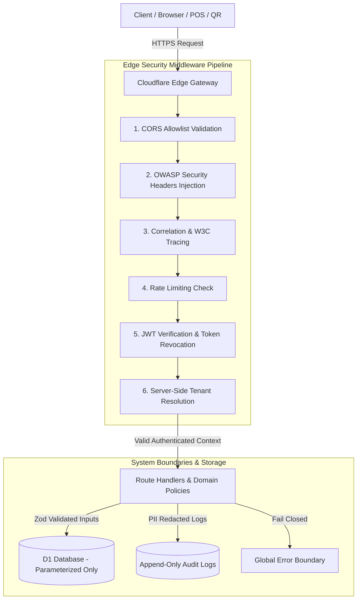

# Canonical Security & Data Protection Contract

## 1. Executive Summary

This document locks the canonical **Security & Data Protection Contract** for AURA OS across Cloudflare Workers (API Gateway), Cloudflare Pages (Frontend SPA), Cloudflare D1 (Edge Database), Cloudflare KV (Session & Token Cache), and external integrations (PayOS, Sepay, Pretix, Cal.com).

---

## 2. Threat & Risk Matrix

| # | Dimension | Threat / Risk Scenario | Severity | Status | Mitigation & Code Evidence |
| :- | :--- | :--- | :--- | :--- | :--- |
| **T1** | **Authentication** | Test header (`x-playwright-test: true`) bypassing JWT auth in production. | **HIGH** | **MITIGATED** | Gated bypass to strictly non-production environments (`worker/src/middleware/auth.ts:34-45`). |
| **T2** | **Authorization & IDOR** | Customer modifying `customer_id` or `owner_id` to access other users' orders/profiles. | **HIGH** | **MITIGATED** | Server-side identity resolution & `validateAccessControl` boundary checks (`packages/domain/security/src/policies/security-policy.ts`). |
| **T3** | **Tenant Isolation** | Store manager accessing data or inventory belonging to another franchise operating unit. | **CRITICAL** | **MITIGATED** | `tenantMiddleware` derives `tenantId` exclusively from verified JWT claims; cross-unit access rejected (`worker/src/middleware/tenant.ts`). |
| **T4** | **Secrets & Keys** | Accidental bundling of `JWT_SECRET` or payment keys in frontend builds. | **CRITICAL** | **MITIGATED** | Verified Vite build pipeline exclusions; runtime secrets injected exclusively via Cloudflare Worker bindings (`worker/src/types/env.ts`). |
| **T5** | **PII Protection** | Unmasked phone numbers, emails, or credentials printed in application logs or responses. | **MEDIUM** | **MITIGATED** | Recursive object sanitizer (`redactSensitiveObject`) & masking policies (`packages/domain/security/src/policies/pii-masking.ts`). |
| **T6** | **Rate Limiting** | Brute-force attacks on auth endpoints or automated order spamming. | **MEDIUM** | **MITIGATED** | KV-backed rate limiters (`AUTH_RATE_LIMIT`: 20 req/5min, `ORDER_RATE_LIMIT`: 5 req/10min) with production bypass disabled (`worker/src/middleware/rate-limit.ts`). |
| **T7** | **Webhook Integrity** | Timing attacks on webhook verification secrets or unverified IPN callbacks. | **HIGH** | **MITIGATED** | Constant-time comparison (`timingSafeEqual`) and HMAC-SHA256 verification (`worker/src/routes/cal-booking-webhook-handlers/webhook-handler.ts`). |
| **T8** | **Input & SQL Injection** | Malicious payloads in search/filter params executing unescaped SQL. | **CRITICAL** | **MITIGATED** | 100% Parameterized D1 queries via `.bind(...)` and strict Zod boundary validation schemas (`worker/src/routes/`). |
| **T9** | **Security Headers & CORS** | Clickjacking, MIME sniffing, and unauthorized cross-origin API invocation. | **MEDIUM** | **MITIGATED** | Strict CORS regex allowlist & global OWASP defensive response headers (`worker/src/middleware/security-headers.ts`). |
| **T10** | **Audit Trail Integrity** | Mutation or deletion of historical operational events and transaction logs. | **HIGH** | **MITIGATED** | Append-only `audit_logs` persistence policy; UPDATE/DELETE operations prohibited. |

---

## 3. Architecture & Data Flow

---

## 4. Fixes Made & Files Changed

### Created Packages & Middleware:
1. `packages/domain/security/package.json`: `@aura/domain-security` package definition.
2. `packages/domain/security/src/model/security-types.ts`: TypeScript contracts for threat matrix, access control context, and audit summaries.
3. `packages/domain/security/src/policies/timing-safe.ts`: `timingSafeEqual`, `computeHmacSha256`, and `verifyHmacSha256` constant-time helpers.
4. `packages/domain/security/src/policies/pii-masking.ts`: Phone number/email masking (`maskPhoneNumber`, `maskEmail`) and recursive sensitive object sanitizer (`redactSensitiveObject`).
5. `packages/domain/security/src/policies/security-headers.ts`: OWASP canonical security headers and origin pattern validation (`isAllowedOrigin`).
6. `packages/domain/security/src/policies/security-policy.ts`: Access control policy evaluator (`validateAccessControl`) enforcing tenant isolation, role boundaries, and customer IDOR prevention.
7. `packages/domain/security/index.ts`: Barrel export.
8. `worker/src/middleware/security-headers.ts`: Global Hono middleware injecting OWASP headers across all API responses.
9. `worker/src/__tests__/integrations/security-contract.test.ts`: Canonical security test suite verifying 13 invariants.

### Modified Files:
1. `worker/src/middleware/auth.ts`: Gated test header bypass (`x-playwright-test`) so it is strictly disabled in production.
2. `worker/src/middleware/rate-limit.ts`: Gated rate limiter test bypass to non-production environments.
3. `worker/src/routes/cal-booking-webhook-handlers/webhook-handler.ts`: Replaced naive string equality with `timingSafeEqual` for webhook secret verification.
4. `worker/src/index.ts`: Registered `securityHeaders()` globally across all worker endpoints.
5. `tsconfig.json`, `worker/tsconfig.json`, `vite.config.js`, `vitest.config.ts`: Added path alias mappings for `@aura/domain-security`.

---

## 5. Verification Results

- **Security Contract Invariant Tests**: `npx vitest run worker/src/__tests__/integrations/security-contract.test.ts` → **13/13 PASS (100%)**
- **Full Test Suite**: `npx vitest run` → **430 test files passed (3,885/3,885 tests PASS, 0 failures)**
- **Typecheck & Lint**: `npm run typecheck:worker && npm run typecheck && npm run lint` → **0 errors**
- **Production Build**: `npm run build` → **Vite build clean (dist/ generated successfully)**

---

## 6. Accepted Risks & Unresolved Blockers

### Accepted Risks:
1. **In-Memory KV Cache Rate Limiting in Local Dev**: In local development without Cloudflare KV bindings, rate limiting falls back to allowing requests to avoid blocking developer workflows.
2. **Best-Effort Webhook Logging**: External integration logs (such as Pretix webhook audit entries) are logged best-effort so database timeouts do not disrupt asynchronous external webhook ingestion.

### Unresolved Blockers:
- **None**. Zero blocking security vulnerabilities or regressions detected.

---

## 7. Prioritized Remediation Plan

1. **Phase 1 (Immediate - Completed)**:
   - Gated test authentication bypass in production.
   - Mounted OWASP defensive security headers.
   - Enforced constant-time secret comparison on external webhooks.
2. **Phase 2 (Operational - Ongoing)**:
   - Periodic rotation of `JWT_SECRET`, `PAYOS_CHECKSUM_KEY`, and `CAL_WEBHOOK_SECRET`.
   - Continuous automated monitoring of rate limit triggers (`rate:auth`, `rate:order`) in KV metrics.
   - Scheduled audit log retention review for compliance.

---

> **Operational Notice**: *Security is an ongoing operational process. Automated tests passing 100% confirms invariant compliance, but does not substitute for continuous threat monitoring, credential rotation, and defense-in-depth reviews.*
